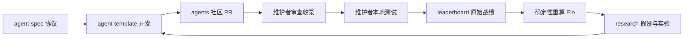

# 架构与职责

| 仓库 | 用途 |
|---|---|
| [.github](https://github.com/ra2-agent/.github) | 组织入口、治理和社区规范 |
| [rust-ra2](https://github.com/ra2-agent/rust-ra2) | 社区引擎分支、Agent 接入、评测与性能优化 |
| [agent-spec](https://github.com/ra2-agent/agent-spec) | Agent 清单、版本与评测协议 |
| [agent-template](https://github.com/ra2-agent/agent-template) | 可复制的 Rust NPC 开发模板 |
| [agents](https://github.com/ra2-agent/agents) | 社区 PR 提交的 Agent 源码和不可变版本 |
| [leaderboard](https://github.com/ra2-agent/leaderboard) | 维护者提交战绩、确定性重算 Elo |
| [research](https://github.com/ra2-agent/research) | 研究路线、实验记录和资料索引 |

引擎研究分支为 [ra2-agent/rust-ra2](https://github.com/ra2-agent/rust-ra2)，来源为 rust-alert/ra2.exe，保留上游历史与 Apache-2.0 许可。引擎仓库运行核心回归；社区提交仓库的 CI 只检查静态文件和计分逻辑，不编译或执行外部 Agent。贡献者提交合规源码，正式评测和结果确认由维护者负责。
